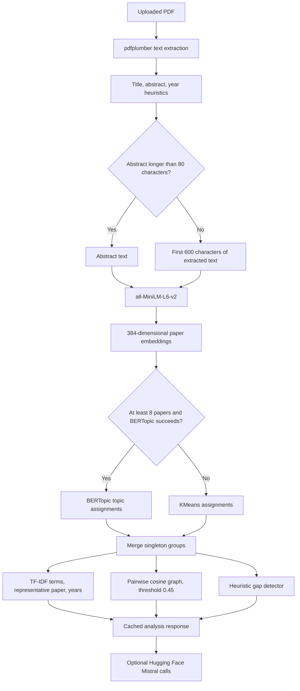

# Model and Analysis Technical Details

## 1. Scope and Terminology

This application is a corpus-analysis pipeline, not one end-to-end model trained for research-gap discovery. It combines:

1. PDF text extraction and heuristic metadata extraction.
2. A pretrained sentence-embedding model for semantic representations.
3. BERTopic or KMeans for assigning papers to topic groups.
4. TF-IDF and cosine-similarity calculations for interpretable cluster evidence and links.
5. Rule-based gap scoring and optional remote large-language-model (LLM) text generation.

The embedding model, topic assignment, keyword extraction, graph edges, and gap rules are separate mechanisms. The optional Mistral model does not create the embeddings or clusters. This distinction matters when interpreting results: the deterministic corpus measurements are not equivalent to an LLM's prose, and neither is a proof that a research opportunity is novel.

## 2. End-to-End Data Flow



The uploaded paper collection and analysis cache are held in process memory (`backend/store.py`). They are not persisted to a database or disk. Restarting the backend clears them.

## 3. PDF and Model Input

### 3.1 Extraction

`backend/routers/upload.py` uses `pdfplumber` to extract text page by page. Papers with no extractable text are skipped. The stored full-text field is truncated to 6,000 characters. Title, abstract, and publication year are derived through regular-expression and positional heuristics; they are not verified against an external bibliographic database.

The year extractor searches publication-related markers in the first 3,000 characters, then checks arXiv-like identifiers and years near the first page, then PDF modification metadata. If it finds no candidate, it assigns 2020. The accepted-year ceiling is hard-coded to 2025 in the current implementation. These rules can select an incorrect year, especially for papers whose first page contains references or multiple dates.

### 3.2 Text passed to the encoder

For each paper, `run_analysis()` chooses:

- the extracted abstract if its stripped length is greater than 80 characters; otherwise
- the first 600 characters of stored extracted text.

The paper title is not concatenated into this encoder input. The selected string is passed to `SentenceTransformer.encode()` without an explicit maximum sequence length or custom truncation setting. The model card states that inputs longer than 256 word pieces are truncated, so long abstracts are not represented in full even though the application may retain more text for display.

This input policy favors abstract-quality papers. A badly extracted or missing abstract can cause the first 600 characters of the paper body, which may contain headers, references, or front-matter noise, to determine its representation.

## 4. Semantic Embedding Model

### 4.1 Identity and purpose

The backend initializes `SentenceTransformer('all-MiniLM-L6-v2')` once when `backend/routers/analysis.py` is imported. The model is the Sentence Transformers release of `all-MiniLM-L6-v2`, based on the MiniLM-L6-H384 family. Its model card describes it as an English sentence and short-paragraph encoder for semantic similarity, information retrieval, and clustering. It maps each input to a dense 384-dimensional vector and has approximately 22.7 million parameters. The published model card lists the Apache-2.0 license and says longer-than-256-word-piece inputs are truncated.

The upstream model was contrastively fine-tuned on more than one billion sentence pairs. That training helps put semantically related short texts near one another in vector space; it does not make this model a research-paper classifier and it is not fine-tuned by this application.

### 4.2 What the vector represents

An embedding is a numeric representation of the selected abstract/text passage. Semantic closeness is estimated by cosine similarity. For vectors $u$ and $v$:

$$
\operatorname{cosine}(u,v) = \frac{u \cdot v}{\|u\|_2\,\|v\|_2}
$$

Cosine similarity is a geometric score, not a probability, calibrated confidence, or measure of scientific truth. It can be negative; a larger value indicates greater directional similarity under this representation. The application rounds scores to three decimal places for its cluster-detail response.

The backend stores each generated vector as a list under the paper's `embedding` field. A later graph request reuses those vectors. Embeddings are recalculated when analysis is run; the vectors and cached result remain in process memory.

### 4.3 Local processing and model download

The embedding model runs in the backend process. Its weights may need to be downloaded from Hugging Face the first time it is initialized, after which the local model cache is used. The optional Mistral calls described later are remote and have a different data path.

## 5. Topic Assignment

### 5.1 BERTopic path

When the corpus has at least eight papers, the application attempts BERTopic:

```python
n_topics = min(8, max(2, n_papers // 4))
topic_model = BERTopic(nr_topics=n_topics, verbose=False, min_topic_size=2)
topics, _ = topic_model.fit_transform(texts, embeddings)
```

The embeddings computed by this application are passed to BERTopic, so the assignment step reuses them rather than needing to encode the documents again. The `nr_topics` value asks BERTopic to reduce the number of topics to a corpus-size-dependent target; it is not a guarantee that exactly that many non-empty topics will be returned.

BERTopic's documented default pipeline reduces embedding dimensions (UMAP), groups documents (HDBSCAN by default), and represents each topic using class-based TF-IDF. The application explicitly sets `min_topic_size=2` but leaves the reduction, clustering, vectorizer, and representation submodels at BERTopic defaults. Those defaults can change with installed package versions. `requirements.txt` does not pin versions.

BERTopic can label outliers with topic ID `-1`. The application initially names this group `Uncategorized`. After BERTopic returns assignments, the application applies its own singleton-group rule, described below.

### 5.2 KMeans fallback

For fewer than eight papers, the code intentionally skips BERTopic. It also catches any exception raised within the BERTopic block and falls back to KMeans. The exception is swallowed without being logged, so a BERTopic configuration or runtime error can silently look like a normal small-corpus fallback.

The primary fallback chooses:

$$
k = \min(\max(2, \lfloor n/3 \rfloor), 6)
$$

and runs `KMeans(n_clusters=k, random_state=42, n_init=10)` directly on the 384-dimensional embeddings. KMeans creates centroid-based, mutually exclusive groups. It requires the number of clusters in advance and works best when groups are reasonably compact around centroids; unlike density clustering, it does not naturally mark outliers.

If every assigned group is a singleton, the application retries with a smaller count:

$$
k = \max(1, \min(6, \lfloor n/2 \rfloor))
$$

KMeans still runs on semantic vectors, not on TF-IDF vectors.

### 5.3 Minimum cluster size and singleton reassignment

After either clustering route, `enforce_minimum_cluster_size()` ensures no displayed group has only one paper:

1. Groups with at least two papers are treated as established groups.
2. Each singleton is reassigned to the established group's mean embedding with the highest cosine similarity.
3. If there are no established groups, the smaller-count KMeans pass is used.

This is a product rule to keep clusters multi-node; it is not a BERTopic guarantee and does not establish that every reassigned paper is a strong semantic fit. The selected cluster centroid is not recalculated after each singleton is moved. An outlier may consequently become a member of its nearest available group even if its similarity is weak.

Fallback cluster labels are generated from the top corpus TF-IDF terms. BERTopic labels are built from its topic words after stop-word filtering. Duplicate labels receive numeric suffixes so each API key remains unique.

## 6. Cluster Keywords and Representative Paper

### 6.1 TF-IDF keywords

The detailed cluster response computes a separate scikit-learn `TfidfVectorizer` over the chosen per-paper texts, using:

| Setting | Value |
|---|---|
| English stop words | Enabled |
| N-gram range | Unigrams and bigrams, `(1, 2)` |
| Maximum vocabulary size | 3,000 features |
| Token expression | ASCII alphabetic-start tokens, at least three characters |
| Ranking | Mean TF-IDF weight across the papers in a cluster |
| Display | Up to eight remaining terms |

The application's academic stop-word set is applied after vectorization to remove generic research language. The top terms summarize vocabulary that is comparatively informative in this corpus. They are not automatically verified topic statements, and the use of a small or homogeneous corpus can make them noisy or overly generic.

These detail keywords use ordinary TF-IDF. BERTopic's own topic-word representation uses its class-based TF-IDF mechanism. They are related but separate calculations and should not be conflated.

### 6.2 Representative paper

For each paper, the backend computes the average cosine similarity to the other members of the same cluster and selects the highest-scoring paper. Its `mean_similarity` value is the selected representative's mean against cluster peers, rounded to three decimals. This is a centrality-style representative, not an independently evaluated “best paper” or quality judgment.

## 7. Cluster Connectivity and Knowledge Graph

### 7.1 Per-cluster graph

The Clusters page's connectivity metrics are derived by comparing every pair of embeddings that share an assigned cluster. A direct undirected edge is added for a pair when:

$$
\operatorname{cosine}(u,v) \ge 0.45
$$

The API returns the threshold, number of direct edges, number of possible pairs, edge density, mean pairwise cosine similarity, connected-component count, largest-component size, strongest pair, and up to 12 strongest above-threshold links.

For a cluster with $m$ papers, the number of possible undirected pairs is:

$$
P = \frac{m(m-1)}{2}
$$

and reported density is $E/P$, where $E$ is the number of pairs at or above 0.45. A connected component is a set of papers reachable through one or more above-threshold edges. Thus, two papers in the same component need not themselves exceed the threshold; there may be a path through an intermediate paper. Papers in different components share a topic assignment but have no path between them at this threshold.

If a multi-paper cluster has no edge at 0.45, the API reports its single strongest pair as below threshold. This makes the closest relation inspectable without incorrectly calling it a qualifying edge.

The threshold is a fixed application setting, not a calibrated decision boundary. Different domains, abstract quality, or embedding model versions may need different thresholds. It must not be interpreted as a universal definition of related research.

### 7.2 Whole-corpus Knowledge Graph

The separate `/api/graph/` endpoint creates nodes for all papers with embeddings and adds an edge when cosine similarity is strictly greater than `0.5`. This graph has a different threshold and comparison rule from the Clusters page (`> 0.5` versus `>= 0.45`), so its edge counts are not expected to match the per-cluster connectivity metrics. The graph endpoint does not use cluster assignments to filter edges.

## 8. Trends and Research-Gap Heuristic

Trends are counts of assigned cluster labels per extracted publication year. They inherit errors in PDF year extraction and cluster assignment; no temporal model or statistical trend test is fitted.

`detect_gaps()` is a hand-written rule system. It returns no candidates for corpora smaller than four papers. For larger corpora it considers non-`Uncategorized` groups and derives a size threshold from cluster median and maximum:

$$
T = \max\left(1, \min(0.4\,\operatorname{median}(s),\;0.25\,\max(s))\right)
$$

where $s$ is the set of cluster sizes. A candidate must be no larger than $T$, have corpus coverage below 12%, and satisfy a temporal rule. “Recent” means publication year at least the median publication year of the corpus, not a fixed recent window such as the last three calendar years. A cluster passes the temporal rule if it has no papers on the recent side of that pivot or has no more recent than older papers.

The reported `confidence` is a weighted heuristic using coverage, size, and the recent/older counts. It has not been calibrated against labeled examples, is not a probability, and is not the result of a significance test. Therefore descriptions such as “statistically verified gap” in some prompts and UI copy overstate what the code establishes. At best, these rules flag small, lower-coverage groups with a simple corpus-relative temporal pattern.

The minimum-two-papers cluster rule and the gap size threshold can interact: for small corpora, the threshold may be below two papers, leaving no cluster eligible regardless of topical importance. “No gaps detected” means only that no group met these particular rules, not that the field is balanced or complete.

## 9. Optional Mistral Generation

### 9.1 Model and service path

The optional generator is `mistralai/Mistral-7B-Instruct-v0.3`, accessed through the Hugging Face Inference API URL configured in `backend/routers/insights.py`. It is not loaded as a local 7-billion-parameter model by this application. The upstream model card describes it as an instruction-fine-tuned version of Mistral-7B-v0.3, with a 32,768-token vocabulary and support for the v3 tokenizer and function calling. The card lists Apache-2.0 and cautions that the model itself has no moderation mechanisms.

The service call is enabled only when `HF_TOKEN` is present in the backend environment. `backend/main.py` calls `load_dotenv()` before importing the insight router, which reads the environment variable at import time. Do not put the token in frontend code or commit it to source control.

Configured generation parameters are:

| Parameter | Value |
|---|---:|
| Temperature | 0.5 |
| Top-p | 0.85 |
| Repetition penalty | 1.15 |
| Maximum new tokens for suggestions | 900 |
| Maximum new tokens for summary | 600 |
| Request timeout | 90 seconds |

### 9.2 What data is sent

The prompts are built from cluster names and paper counts, gap topics and rule-generated reasons, and the total paper count. The current prompt builders do not send full PDFs or full abstracts. However, cluster names and gap descriptions are derived from uploaded material, so the remote service still receives corpus-derived information. Anyone handling confidential or unpublished work should account for that data flow before enabling `HF_TOKEN`.

### 9.3 Output handling and fallback

The suggestions prompt asks for exactly five future directions in a structured format. If a successful response can be parsed, up to five suggestion objects are returned. If it cannot be parsed, raw model text may be returned. If no token is configured, the request fails, the model is loading, the response is non-200, or the HTTP call raises an exception, the application silently uses a rule-based fallback for suggestions. Summary generation similarly falls back to a templated summary.

The model's statements are not checked against citations, a scholarly index, the uploaded full text, or external literature. The prompt's instructions to be “verified,” “novel,” and “specific” are requests to the generator, not verification mechanisms. Rule-based fallback statements can also assert unsupported claims (for example, absence of a type of research) because the fallback templates do not query the papers for that evidence.

## 10. API and Cached Outputs

The principal analysis route is `GET /api/analysis/run`. The cache stores:

| Key | Meaning |
|---|---|
| `clusters` | Cluster label to paper records, including title, year, and abstract excerpt |
| `cluster_details` | Keywords, method, year distribution, representative paper, and connectivity metrics |
| `trends` | Per-year counts by cluster label |
| `gaps` | Groups passing the configured size, coverage, and temporal rules |
| `topic_labels` | Labels used by the clustering result |
| `total_papers` | Papers included in the current run |

`GET /api/analysis/clusters` returns the paper groups and detail object when a result is cached; if not, it triggers analysis. `/api/analysis/trends` and `/api/analysis/gaps` also trigger analysis when necessary. The process-local cache is invalidated when PDFs are uploaded or cleared.

## 11. Reproducibility, Performance, and Known Limitations

- KMeans has `random_state=42` and `n_init=10`; BERTopic's UMAP/HDBSCAN behavior is not explicitly seeded or configured here.
- The broad exception handler around BERTopic hides the reason for fallback. Logs should be added before treating BERTopic results as reproducible.
- Package versions are unpinned in `backend/requirements.txt`; upstream defaults and generated clusters can vary by environment.
- The model embeds only one abstract or short body prefix per paper. Full paper methods, results, references, tables, and appendices are not systematically analyzed.
- PDF extraction and metadata heuristics can introduce text noise, title errors, and year errors. Scanned/image-only PDFs may yield no text without OCR.
- KMeans imposes a fixed number of centroid groups and can force papers into groups; BERTopic can identify outliers, but this application subsequently reassigns singleton groups.
- Keyword frequency and embedding proximity describe corpus structure; they do not measure paper quality, methodological rigor, causality, or novelty.
- Cosine thresholds and hand-authored gap rules have no calibration or held-out validation in this repository.
- The current gap rules use the median corpus year as a temporal pivot and a hard-coded upload-year maximum of 2025; both can make current-year trend interpretations misleading.
- Model outputs are not accompanied by paper-level citations or evidence spans in the current API.
- All paper records and embeddings are in-memory. There is no user isolation, database persistence, deduplication, or durable audit trail in `backend/store.py`.

## 12. Recommended Evaluation Before Academic Use

Treat this application as an exploratory literature-mapping aid. Before using its conclusions in a thesis, systematic review, or funding decision:

1. Manually inspect PDF extraction, title, abstract, and year for every included paper.
2. Have domain experts inspect representative papers and cluster boundaries, especially singleton reassignments and low-similarity members.
3. Vary the 0.45/0.5 graph thresholds and compare whether major connectivity conclusions remain stable.
4. Compare clustering with a labeled or expert-reviewed sample and report a suitable clustering evaluation, rather than relying on visual plausibility alone.
5. Validate gap rules on a benchmark or expert-labeled corpus; calibrate any confidence score and define recency explicitly.
6. Require citations to the source papers for every generated research direction and verify novelty against external scholarly databases.
7. Record package versions, model revision, preprocessing settings, random seeds, input-paper identifiers, and analysis timestamp for reproducible runs.

## 13. References

- Sentence Transformers model card, `all-MiniLM-L6-v2`: <https://huggingface.co/sentence-transformers/all-MiniLM-L6-v2>
- Sentence Transformers semantic similarity documentation: <https://www.sbert.net/docs/sentence_transformer/usage/semantic_textual_similarity.html>
- BERTopic algorithm and default pipeline: <https://maartengr.github.io/BERTopic/algorithm/algorithm.html>
- BERTopic topic-reduction guide: <https://maartengr.github.io/BERTopic/getting_started/topicreduction/topicreduction.html>
- scikit-learn KMeans reference: <https://scikit-learn.org/stable/modules/generated/sklearn.cluster.KMeans.html>
- scikit-learn text feature extraction and TF-IDF: <https://scikit-learn.org/stable/modules/feature_extraction.html#text-feature-extraction>
- Mistral-7B-Instruct-v0.3 model card: <https://huggingface.co/mistralai/Mistral-7B-Instruct-v0.3>

## 14. Repository Implementation References

- PDF extraction and year/title/abstract heuristics: `backend/routers/upload.py`
- Embedding, clustering, labels, connectivity, trend, and gap computation: `backend/routers/analysis.py`
- Whole-corpus similarity graph: `backend/routers/graph.py`
- Optional generation prompts, Hugging Face call, parsing, and fallback: `backend/routers/insights.py`
- In-memory storage and cache: `backend/store.py`
- Environment loading and router registration: `backend/main.py`
- Runtime dependencies: `backend/requirements.txt`